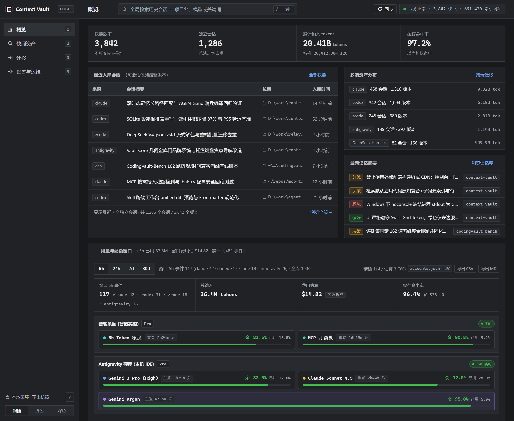
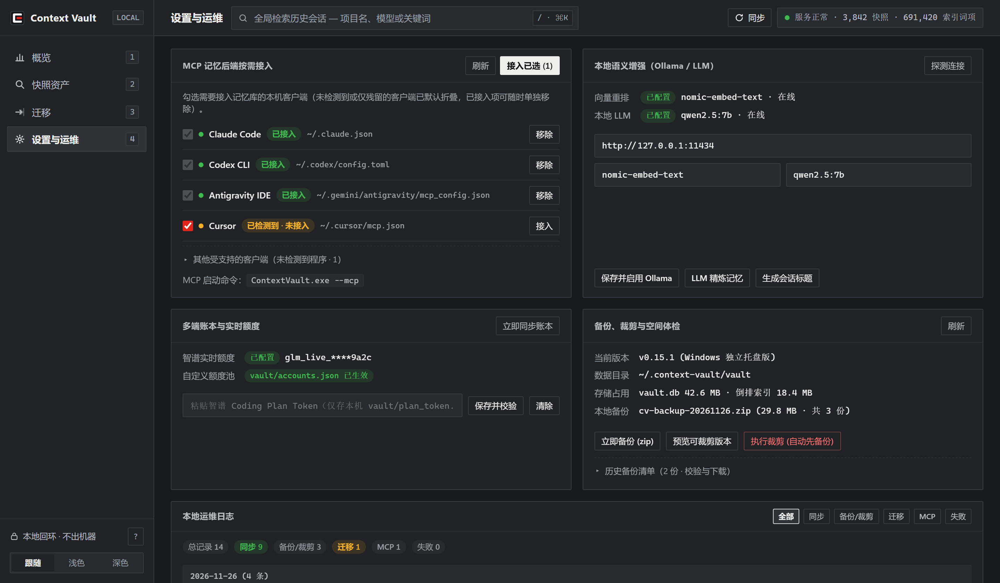
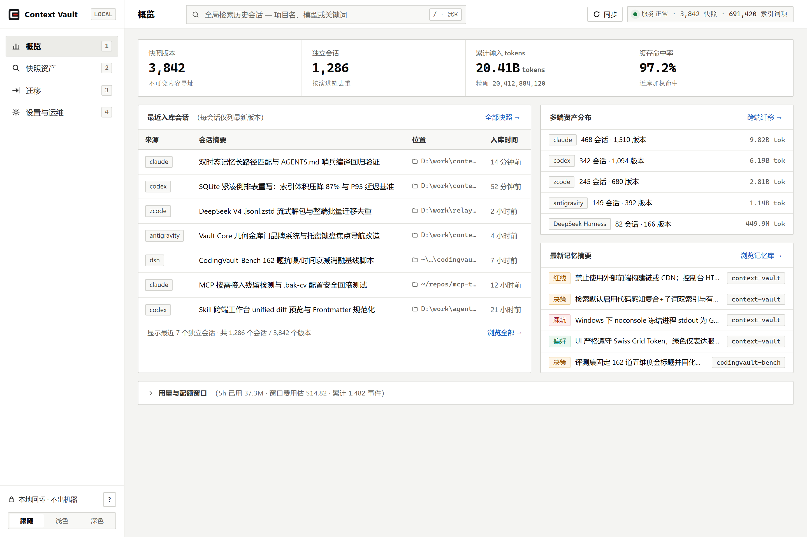

[**简体中文**](README.zh.md) | **English**

# Context Vault

[Website](https://vault.nghqqa.cn/) · [](https://github.com/nghqqa/context-vault/actions/workflows/ci.yml)
[](https://github.com/nghqqa/context-vault/releases)
[](LICENSE)
[](https://www.python.org/)

> **A local-first asset vault for AI coding sessions** — snapshots you own, migration that's honest, a ledger you can audit, memory that cites its sources.

Your AI coding sessions are your most valuable work asset — yet they're locked inside each agent's private format. Switch models, switch relays, switch tools, and the context resets to zero. Context Vault turns it into a **neutral asset on your own machine**. Agents come and go; the vault stays.

- 79.7% of developers use two or more AI coding tools every week (Stack Overflow 2026) — context scattered across vendors.
- Every migration tool on the market is a one-shot **porter**. None of them is an **asset vault** (persistent store, content addressing, lineage, ledger, audit trail).
- Lock-in is not going to fix itself: vendors benefit from it.

## 🖥️ Console Preview

> Loopback-only `http://127.0.0.1:8791/` · Swiss International Style · Light / Dark / System · **Parallel SWR first-load (< 100ms)**

<p>
  
</p>
<details>
  <summary>Expand: Settings &amp; Ops Workbench (1-click MCP / Ollama / Backup &amp; Prune) &amp; Light Theme</summary>
  <p></p>
  <p></p>
</details>

## ✨ Features

- **Snapshot vault** — export Codex / Claude Code / ZCode / Antigravity / DeepSeek Harness (`dsh`) / 18 bridged harnesses into the vendor-neutral [context-snapshot](docs/snapshot-format.md) format: content-addressed, immutable, idempotent, with automatic lineage (`parent_snapshot` trees & forks) and daily retention pruning (`cv prune`).
- **Handoff brief** — `--target markdown --budget-tokens 4000` assembles a utility-maximized brief under an explicit token budget (stop state / active decisions / disproven dead-ends / touched-file topology / live-context tail), folding repeated file reads and duplicate errors, with compression stats.
- **Vault backup** — `cv backup`: consistent sqlite snapshot + rotated zips; optional `CV_SERVE_TOKEN` auth for the resident console.
- **Honest migration & bidirectional sync** — bidirectional Codex ⇄ Claude Code, native Antigravity `.db`/Proto round-trip & project-tree batch sync/cleanup, native DeepSeek Harness V4 concatenated-Zstd write-back (`workspace.json` + `session_projcache` sync), experimental ZCode write-back (with auto-backup), **full-harness batch session migration** (`cv import --agent <src> --target <tgt> [--no-skip-migrated]` and Web Console **Migrate → Session Migration → Full-Harness Batch**, supporting source/project/query filters, automatic same-origin & `migrations.jsonl` deduplication, per-item fault tolerance, and single bulk ZCode DB backup), dry-run by default, and a per-migration report of exactly what survives and what doesn't.
- **Cross-agent Skill workbench** — `cv skills` (`list|inspect|migrate|remove|backups|rollback`) and the Web Console **Migrate → Skill Migration** tab discover, inspect unified diffs + file deltas, safely remove with auto-backups, and roll back `SKILL.md` packages across ZCode, Claude Code, Codex, Antigravity, Cursor, and DeepSeek Harness (`connected_only=1` in UI aligns visible sources/targets with active MCP backends, hides 0-skill tools, and auto-switches colliding targets) with prompt-token budget warnings and toggleable Antigravity output modes (`skills` dir vs. reversible `plugin.json` bundle).
- **Deep retrieval core** — code-aware tokenization (camelCase/snake_case/path/error-code composite+subword dual indexing), block-role-weighted BM25 (global IDF + length normalization), lineage folding (chain hits collapse to the latest version), time decay and optional dense-vector RRF; a compact SQLite inverted index replaces the giant pickle.
- **Open reproducible benchmark** — `python benchmarks/run_bench.py` reproduces a 162-query, 5-dimension ablation (full v0→v2 evolution) in ~30s; see [docs/BENCHMARK.md](docs/BENCHMARK.md).
- **Token ledger** — per-model costs, cache hit rates aggregated from usage records *inside your own session files*. No proxy required. `cv ledger sync` directly harvests Claude Code / Codex / ZCode / Antigravity / DeepSeek Harness local logs (read-only, idempotent) into a `usage_events` time series, and `cv ledger quota` reports the 5-hour rolling window, recovery ETA, 7d/monthly runway (optional `vault/accounts.json` quota pools) and per-model/project/account rankings — fully offline, no headroom required.
- **Cross-session temporal memory & rules compiler** — decisions, preferences, summaries, pitfalls and hard constraints auto-extracted from history with exact provenance (snapshot#block + real session time) and topic signatures; when a decision is superseded, stale memories are marked and hidden by default (`include_history` traces the full evolution chain). `cv memory compile-rules` (and the Web Console Memory view) compiles active project memories within a token budget into sentinel-protected `AGENTS.md` / `CLAUDE.md` / `.cursorrules` files while preserving handwritten sections.
- **Bidirectional MCP backend** — 8 tools (`vault_remember`, `vault_memorize`, `vault_handoff`, `vault_context`, `vault_search`, `vault_recent`, `vault_snapshot`, `vault_stats`) turn any MCP client (Claude Code / Codex / Cursor / Antigravity / DeepSeek Harness Cordis patch) into a persistent, writing-back agent with `project`/`agent`/`since` scoped filtering and `budget_tokens` trimming; selective multi-client onboarding (`--clients`) & safe uninstall (`cv mcp uninstall`, skipping uninstalled residual dirs).
- **AML Add/Search adapter** — `cv-aml` / `tools/aml_adapter.py` (and `/aml/add`, `/aml/search` mounted on `cv serve`) with tenant isolation, `request_id` idempotent replay & `409 Conflict` detection, plus a zero-dep `Dockerfile.aml`.
- **Optional secret redaction** — `cv export --redact` or `CV_REDACT_SECRETS=1` masks common API keys, GitHub/AWS tokens, JWTs and PEM private keys before persisting snapshots.
- **Optional local semantic layer (Ollama / LLM)** — `cv semantic` (and the Console **Settings & Ops** tab) configures local Ollama dense reranking, LLM memory distillation, and automatic session titles; off by default with zero outbound traffic.
- **Instant local Web Console** — `Ctrl/Cmd+K` global palette, empty-vault 3-step onboarding, manual memory pinning & rules compiler, budgeted Markdown brief 1-click copy, selective MCP / backup / prune controls, and non-blocking SWR quota caching.

## 🚀 Quick Start

> **Windows ready-to-run tray app (no Python required, 14.5 MB single binary)**: Download [ContextVault.exe (v0.14.0)](https://github.com/nghqqa/context-vault/releases/download/v0.14.0/ContextVault.exe) ([Release notes & SHA256](https://github.com/nghqqa/context-vault/releases/tag/v0.14.0)) and double-click to launch the resident Web Console (`127.0.0.1:8791`), **built-in zero-Python MCP server (`--mcp`)**, periodic sync, and daily backups.

```bash
pip install -e .                   # optional: installs global `cv`, `cv-mcp`, `cv-aml` commands (zero deps)
cv setup --mcp                     # one-shot onboarding: init → sync → ledger → memory → MCP install (--mcp-clients a,b)
cv serve --open                    # start web console + hot index + unified /aml/* API & open browser
```

Or run directly without installation (zero dependencies, Python 3.9+):

```bash
python tools/cv.py doctor              # environment check (Python, session sources, DSH Zstd, MCP summary)
python tools/cv.py sync                # auto-ingest all local session sources (incremental + lineage)
python tools/cv.py serve               # web console at http://127.0.0.1:8791
python tools/cv.py mcp install --all   # register MCP in detected apps (or --clients claude,dsh)
python tools/cv.py mcp uninstall --client cursor  # safely remove context-vault entry (.bak-cv backup)
```

Migrate a session (dry-run by default — nothing touches real session dirs without `--apply`):

```bash
python tools/cv.py migrate ~/.claude/transcripts/ses_xxx.jsonl --target codex
python tools/cv.py import cv_xxxx --target codex --apply
python tools/cv.py import --agent claude --target codex     # full-harness batch dry-run
```

For the full CLI reference, Windows `.exe` guide, scenario playbooks, environment variables, and troubleshooting, see **[docs/USAGE.en.md](docs/USAGE.en.md)** (English) or **[docs/USAGE.md](docs/USAGE.md)** (中文完整手册).

## 📦 What survives a migration

Honesty first — this is the whole table, not a highlight reel:

| Data | Status | Notes |
|---|---|---|
| Conversation & paired tool calls/results | ✅ carried | unpaired results are dropped and **counted** in the report |
| Reasoning / thinking summaries | ⚠️ partial | signatures & encrypted content are not portable — dropped by [spec §3.2](docs/snapshot-format.md) |
| Compaction boundaries | ✅ carried | become summary blocks; stateless-replay semantics |
| Developer-injected blocks (env etc.) | ❌ filtered | re-injected by the target agent's runtime |
| Token usage records | ✅ carried | lands in the ledger, not the migrated session |
| Sub-agent transcripts · images | ❌ not yet | |
| env / hooks / MCP config / permissions | ❌ stays with source | cannot and should not be moved |

## 🧠 Memory backend — API at a glance

| MCP tool | Purpose |
|---|---|
| `vault_remember(query[, kind, project, since, include_history])` | long-term memory with `#id` and snapshot/time provenance (superseded-chain aware) |
| `vault_memorize(content[, kind, project, pinned, supersedes])` | persist a new decision, constraint, pitfall, or preference directly to `memory_items` (snapshots stay immutable) |
| `vault_handoff([id, project, budget_tokens, include_memories])` | budgeted five-slot cross-tool handoff brief with active project memories |
| `vault_context(query[, project, agent, since, budget_tokens])` | relevant excerpts from history for the task at hand |
| `vault_search(query[, project, agent, since, budget_tokens])` | full-text search over all snapshots (hot index & cold scan equivalent) |
| `vault_recent(limit)` | recent snapshots |
| `vault_snapshot(id)` | single snapshot detail (block distribution, live context, tokens) |
| `vault_stats()` | token ledger summary |

Ask your agent at the start of a task: *"what did we decide about X before?"* — it queries your own history, locally.

## 🗄️ How it works

```
vault/
├── snapshots/cv_*.json   # immutable, content-addressed (sha256 → id); lineage inside
├── vault.db              # index: search terms, ledger + usage_events, memories, audit, sync watermarks
├── outbox/               # dry-run migration output (never touches real dirs)
└── backups/              # cv backup: consistent zips, rotated
```

Two rules that don't bend: **snapshots are immutable** (any derived data lives in the index layer, never rewritten into snapshots), and **source session files are read-only** (the vault never modifies what an agent wrote). `cv serve` binds to loopback only, validates Host/Origin, and requires JSON content-type on writes — local processes work, drive-by web pages don't.

## Verified on a real machine (2026-10-27/29)

- 195 MB Codex rollout → 12 MB snapshot in **1.5 s**; 39 compaction boundaries, 224M tokens of usage, 838 tool-call pairs intact.
- **Bidirectional migration, both directions real-machine verified**: Codex→Claude resumes and continues accurately in Claude 2.1.181; Claude→Codex restores **373,160 tokens of full context** in Codex 0.153.4.
- Reverse-engineered and dodged the two-generation Codex format trap (numeric vs string `ordinal`, resume reading the SQLite thread-store, misleading "rollout is empty").
- Test suite: **268 tests** including hot/cold three-way equivalence with `project`/`agent`/`since` scoped filtering (and evolution-chain leaf `since`), bidirectional MCP (`vault_memorize` with `supersedes`, `vault_handoff`, 401/legacy-404 cold fallback), project rules compiler (`cv memory compile-rules` sentinel safety, `.bak-cv` backups & HTTP path guards), SWR non-blocking caching, DeepSeek Harness V4/Zstd/Cordis round-trip, full-harness batch session migration (`plan_batch_migration` / `run_batch_migration` / `/migrate/batch` / `cv import --agent`), selective MCP install/uninstall with residual isolation, cross-agent skill workbench (`inspect` diff, safe `remove`, verified `rollback`, `connected_only` enforcement & self-invalidating caches), HTTP security headers / IPv6 guard / pre-body auth rejection, `/stats` & DB migration caching, 413 payload guards, and gzip compression — the resident index and the file-scan fallback must return identical results. Real-machine verified in **DeepSeek Harness Desktop** (live MCP tool invocation, migrated Antigravity V4 `.jsonl.zstd` session rendering, and `/tdd` Skill recognition), **Claude Code 2.1.181**, and **Codex 0.153.4**. CI runs JS syntax/runtime/unit checks (`S1-S8`, `MB1-MB4`, `MR1a-MR1d`), a real-browser visibility + layout probe (380–2560px × all views, 32/32 OK, zero overflow), stdlib-only 26-module verification, and package smoke tests across Linux, Windows, and macOS.

## Design principles

1. **Read-only sources, never rewrite traffic** — the asset layer is strictly separate from the transport layer (proxies/gateways). Remove the proxy, reinstall it: the vault loses nothing.
2. **Honest over complete** — snapshots carry `completeness` flags; migration diffs list what cannot move; ledger estimates are labeled as estimates.
3. **Stateless replay** — server-side state is not portable; the live context is what follows the last compaction boundary, with summaries injected as the new session's first message.

## Dependencies & data sources

**Core features have zero external dependencies** (pure Python 3.9+ stdlib, modular architecture, `pip install -e .`). The token ledger works from usage records inside your own session files. Optional integrations (headroom proxy, relay billing APIs) are enhancements with environment-variable fallbacks (`CV_RELAY_PROFILES`, `CV_RELAY_KEY`) — see [README.zh.md](README.zh.md) for the full boundary table. Uninstall every integration: the vault loses one byte of nothing.

## 🆚 How this relates to neighbors

| | Context Vault | porters (session-migrate · txcript · `/import`) | memory layers (Mem0 · Letta) | proxies (headroom · LiteLLM) |
|---|---|---|---|---|
| Layer | **asset vault** | converter | memory | transport |
| Immutable content-addressed store + lineage | ✅ | — | — | — |
| Bidirectional migration | ✅ native 5 + bridged 18 | ✅ | — | — |
| Token ledger from session files | ✅ | — | — | own traffic only |
| Memory with provenance | ✅ (temporal engine v2, with conflict superseding; pluggable) | — | ✅ | — |
| Open format spec | ✅ [CC-BY](docs/snapshot-format.md) (txcript mapping included) | txcript `Simple` | — | — |

Porters are upstream adapters, not competitors — `cv ingest` and `cv export-harness` literally shell out to session-migrate for 18 formats. The vault owns what they don't: storage, lineage, ledger, audit.

## Harness matrix

| Channel | Coverage |
|---|---|
| Native read+write (real-machine verified) | Codex · Claude Code · Antigravity `.db`/Proto · DeepSeek Harness V4 Zstd · ZCode transcripts (read + experimental write-back) |
| Bridged read (`cv ingest`, 18 formats) | opencode · cursor · qwen · kimi · grok · antigravity · copilot · devin · hermes · kilo · mastracode · muse · omp · pi · vibe · openhands … |
| Bridged write (`cv export-harness`, 18 targets) | same list |
| Ledger sources | Claude Code · Codex · Antigravity · DeepSeek Harness · headroom · relay billing API · ZCode usage audit |
| Not supported | harnesses with encrypted local stores (e.g. Windsurf) |

## Roadmap

- **M0 ✅** format spec v0.1 · dual-source export · ledger import · probe
- **M1 ✅** SQLite vault · bidirectional migration (verified both ways) · diff preview
- **M2 ✅** resident service + web console · MCP backend · cache warming · sentry/watch · 18-format bridged intake
- **M3 ✅** memory layer (pluggable engine) · fork/tree lineage · audit timeline
- **M4 ✅** deep retrieval core (code-aware BM25 + lineage folding + SQLite inverted index) · temporal memory (superseded conflict resolution) · budgeted handoff compression · CodingVault-Bench open ablation
- **M5 ✅** local multi-client ledger & 5h quota ETA · native Antigravity WAL sync · AML multi-tenant adapter · local Ollama semantic layer (`cv semantic`) · Web Console Settings & Ops workbench · parallel SWR sub-100ms load · slim 14 MB zero-Python Windows tray with native `--mcp`
- **Next** macOS/Linux tray companion · optional encrypted backups · community feedback iterations

## FAQ

**How is this different from just reading `~/.claude/projects` myself?** You can — once, for one format, on one machine. The vault gives you one queryable store across every harness and month, with lineage when sessions evolve, an audit trail when upstreams change, and memory extraction over all of it.

**Does anything leave my machine?** No. No telemetry, no accounts, no API keys needed for core features. `serve` binds to 127.0.0.1; `probe` only calls the relay endpoints you configure.

**Is it free?** Completely free, with no paid plans. Core code is MIT open source and the format spec is CC-BY; the ready-to-run Windows tray binary (`ContextVault.exe`) is also distributed free on [GitHub Releases](https://github.com/nghqqa/context-vault/releases).

## Contributing

Issues and PRs welcome. Format-spec discussions are the highest-value contributions — [snapshot-format.md](docs/snapshot-format.md) is the product.

## License

Code **MIT** · format spec **CC-BY** ([snapshot-format.md](docs/snapshot-format.md)). All features and the Windows tray release are free to use.
