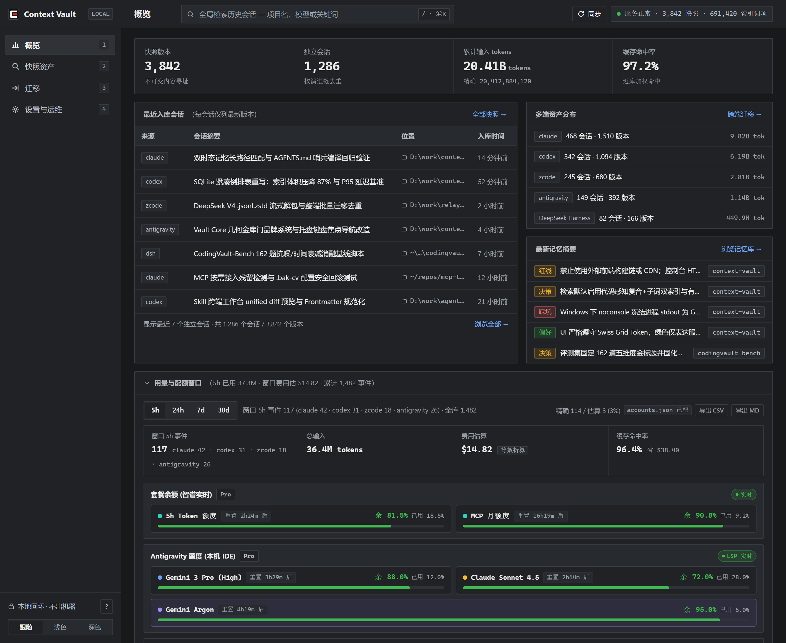
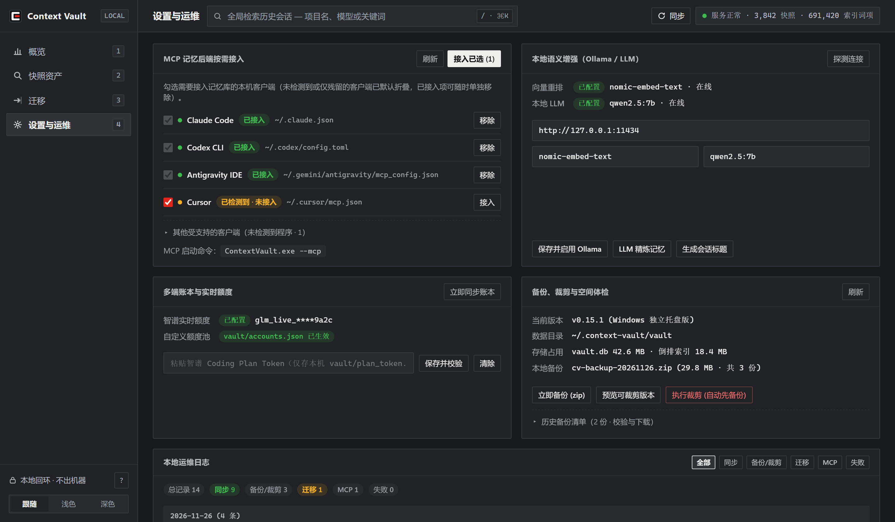

# Context Vault User Guide (English)

> Looking for the full Chinese reference? See [docs/USAGE.md](USAGE.md).

Context Vault is a **100% free, local-first, zero-dependency** asset vault for AI coding agent sessions (Claude Code, Codex, Antigravity, DeepSeek Harness, ZCode, plus 18 bridged harnesses). All data stays on your machine; source session files are strictly read-only.

---

## 1. 3-Minute Quick Start

### Option A — Windows Ready-to-Run Tray Binary (No Python Required, 14.4 MB)
1. Download [`ContextVault.exe`](https://github.com/nghqqa/context-vault/releases/download/v0.12.0/ContextVault.exe) from [GitHub Releases (v0.12.0)](https://github.com/nghqqa/context-vault/releases/tag/v0.12.0) and optionally verify via `SHA256SUMS.txt`:
   ```powershell
   certutil -hashfile ContextVault.exe SHA256
   ```
2. Double-click `ContextVault.exe` (if Windows SmartScreen shows an unknown-publisher dialog on first run, click **More info → Run anyway**). The tray icon appears in the system tray and starts the local Web Console at `http://127.0.0.1:8791/`.
3. **Zero-CLI Onboarding**: On an empty vault, the Overview displays a 3-step guide to sync all local sessions, sync the multi-client token ledger, and select which MCP clients to connect (Claude Code / Codex / Cursor / Antigravity / DeepSeek Harness) via **Settings & Ops (`4`)** — the `.exe` itself runs as a native `--mcp` stdio server without Python!
4. **Data location & uninstall**: Standalone runs store data in `~/.context-vault/vault` (recorded in `~/.context-vault/config.json` so moving the `.exe` never loses your vault). To uninstall, disable autostart in the tray menu, exit, and delete the `.exe` and `~/.context-vault/`.

### Option B — Cross-Platform CLI (Windows / Linux / macOS, Python 3.9+, Zero Dependencies)
```bash
git clone https://github.com/nghqqa/context-vault && cd context-vault
pip install -e .        # registers global `cv`, `cv-mcp`, `cv-aml` (0 third-party deps)
cv setup --mcp                       # init -> sync sessions -> ledger -> memory -> install MCP (skips residuals)
cv setup --mcp --mcp-clients claude,dsh  # or choose explicit MCP clients
cv serve --open                      # start resident hot-index server & open Web Console automatically
```
> Without `pip install -e .`, replace `cv <cmd>` with `python tools/cv.py <cmd>`. Pass `--vault <dir>` before the subcommand to target a custom directory (default `./vault`).

---

## 2. Web Console Tour & Shortcuts



- **`1` – `4`**: Switch between **Overview**, **Snapshots**, **Migrate**, and **Settings & Ops**.
- **`Ctrl+K` / `Cmd+K`**: Open the global command palette (instant live search across both cross-session memories and snapshots).
- **`/`**: Focus global search; **`Esc`**: close drawer or palette.
- **Settings & Ops (`4`)**: Selective MCP detection, per-client installation & safe removal (distinguishes real client binaries from uninstall residual dirs, collapses undetected entries, creates `.bak-cv` backups), local Ollama embeddings/LLM setup & distillation, quota token config & ledger sync, and consistent zip backup / snapshot pruning.



---

## 3. Core Playbooks

### Sync & Redacted Export
```bash
cv sync                                           # incremental scan across Claude / Codex / ZCode / Antigravity / DSH
cv sync --debounce                                # background cadence (max 1 snapshot per 30 min per active session)
cv export ~/.claude/transcripts/ses_xxx.jsonl --redact  # redact API keys / JWTs / PEM keys before storing
```

### Honest Bidirectional Migration & Budgeted Markdown Briefs
Migrations are **dry-run by default** (written to `vault/outbox/`). Pass `--apply` only when ready to write into the target agent's live directory.
```bash
cv migrate ~/.claude/transcripts/ses_xxx.jsonl --target codex      # preview + outbox
cv import cv_xxxx --target codex --apply                           # write into Codex sessions
cv import cv_xxxx --target dsh --apply                             # write DSH V4 .jsonl.zstd + workspace registration
cv import cv_xxxx --target markdown --budget-tokens 4000           # 5-slot utility handoff brief
```
In the Web Console **Migrate (`3`)** tab, selecting **Markdown** lets you choose a token budget (`2K / 4K / 8K / Unlimited`) and copy the generated handoff brief in one click.

### Cross-Agent Skill Workbench (`SKILL.md` Packages)
```bash
cv skills list --source zcode                                                    # inspect local skills & prompt-token cost
cv skills inspect academic-figure-prompt --source zcode --target antigravity     # inspect normalized SKILL.md, unified diff & file deltas
cv skills migrate --from zcode --to dsh                                          # dry-run for DeepSeek Harness (~/.dsh/skills/)
cv skills migrate --from zcode --to antigravity --agy-mode plugin --apply        # bundle as toggleable Antigravity plugin
cv skills remove --target antigravity --only archify --apply                     # backup to vault/backups/ before safely deleting
cv skills backups                                                                # list restorable overwrite/removal skill backups
cv skills rollback skills-20261125-000001-remove --apply                         # restore backed-up skill directory after path verification
```
In the Web Console **Migrate (`3`) → Skill Migration**, source/target availability automatically tracks your connected MCP backends (hiding unconnected clients and 0-skill sources, auto-switching colliding targets); open the per-row **Preview / Diff** drawer before overwriting, manage target skills with automatic backup-before-delete + 1-click rollback, and switch Antigravity output between **Global Skills Dir** and **Reversible Plugin Bundle (`plugin.json`)**.

### Cross-Session Temporal Memory & MCP
```bash
cv memory extract                        # extract decisions, preferences, pitfalls, constraints with provenance
cv memory search "SQLite WAL"            # active facts only (superseded decisions hidden by default)
cv memory search "SQLite WAL" --history  # trace full A -> B -> C evolution chain
cv mcp status                            # inspect detected binaries vs uninstall residual dirs
cv mcp install --all                     # register MCP in detected apps (or --clients claude,dsh)
cv mcp uninstall --client cursor         # remove context-vault safely (supports --clients a,b; writes .bak-cv backup)
```
MCP tools exposed (`cv-mcp` / `ContextVault.exe --mcp`): `vault_remember`, `vault_context`, `vault_search`, `vault_recent`, `vault_snapshot`, `vault_stats` (retrieval tools support `budget_tokens` trimming).

### Local Multi-Client Token Ledger & Quota ETA
```bash
cv ledger sync                       # read-only harvest from Claude / Codex / ZCode / Antigravity / DeepSeek Harness
cv ledger quota --window 5h          # rolling 5h window, cooldown ETA, per-model/project/client rankings
cv ledger limit --list               # optional custom quota caps in vault/accounts.json
```

### Unified AML Add/Search Adapter & Docker
`cv serve` natively mounts `/aml/add` and `/aml/search` (tenant-isolated via `user_id`, idempotent via `request_id` / `Idempotency-Key` with `409 Conflict` detection). Standalone server:
```bash
cv-aml --serve --port 8792 --vault ./vault
# or container: docker build -f Dockerfile.aml -t context-vault-aml .
```

### Optional Local Semantic Layer (Ollama / Local LLM)
Off by default (zero outbound traffic unless explicitly configured):
```bash
cv semantic setup --ollama --host http://127.0.0.1:11434 --embed-model nomic-embed-text --llm-model qwen2.5:7b
cv semantic status --probe
cv semantic refine --limit 10        # distill cross-session memories with local LLM
cv semantic titles --limit 30        # generate concise session titles
```

### Backup, Pruning & Diagnostics
```bash
cv backup --keep 10                  # consistent online SQLite backup + snapshots zip rotation
cv prune                             # dry-run: keep daily last + leaves + forks + orphaned chains
cv prune --apply                     # auto-backup first, then prune intermediate versions
cv doctor                            # inspect Python, local agent dirs, DSH Zstd backend, MCP summary & DB health
```

---

## 4. Security, Privacy & Key Environment Variables

- **Read-only source files**: Context Vault never modifies original agent session logs.
- **Loopback-only HTTP**: `cv serve` binds strictly to `127.0.0.1` with Host/Origin checks, `POST` JSON enforcement, 32 MB body cap (`413`), and optional `--token` / `CV_SERVE_TOKEN` auth.
- **No telemetry, no accounts, 100% free**: Core code is MIT; format spec is CC-BY; Windows tray binary is free on GitHub Releases.

| Variable | Purpose |
|---|---|
| `CV_VAULT` | Default vault directory path |
| `CV_SERVE_TOKEN` | Enable auth token for `cv serve` & Web Console |
| `CV_REDACT_SECRETS=1` | Automatically redact API keys / tokens / PEM blocks on export |
| `CV_EMBEDDINGS_URL` / `CV_EMBEDDINGS_MODEL` | Optional OpenAI-compatible embeddings endpoint for hybrid reranking |
| `CV_LLM_URL` / `CV_LLM_MODEL` | Optional OpenAI-compatible LLM endpoint for memory refinement & titles |
| `CV_PLAN_TOKEN` | Optional Coding Plan token for live remote quota bars |
| `CV_RELAY_PROFILES` / `CV_RELAY_KEY` | Optional upstream relay endpoints for `cv probe` sentinel |
| `DSH_HOME` | Override DeepSeek Harness home dir (defaults to `~/.dsh`) |
