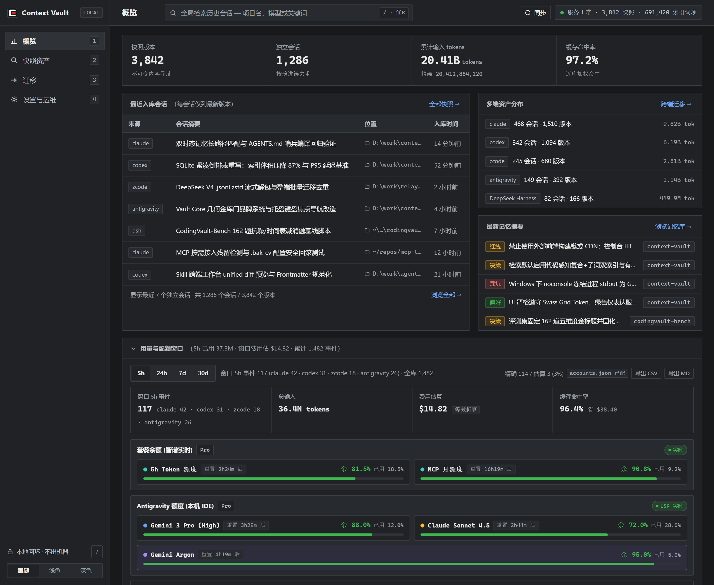
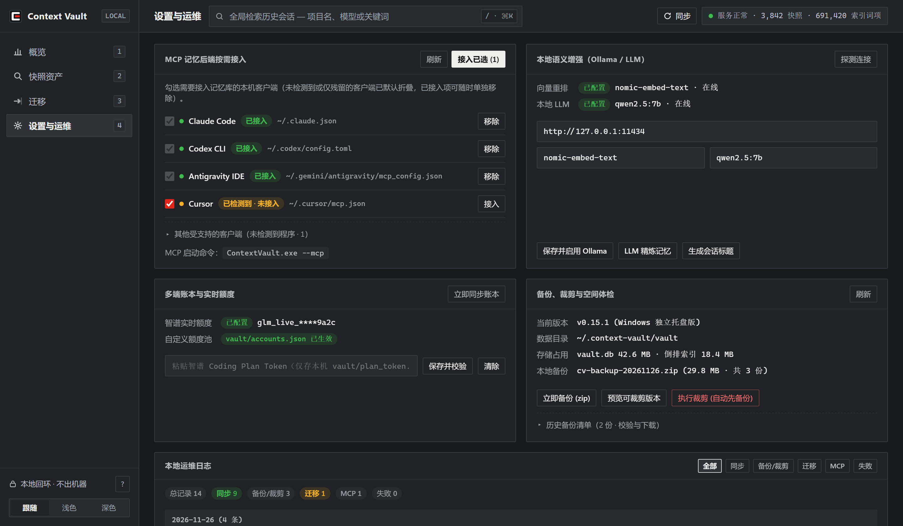

# Context Vault 完整用户手册

本手册面向日常使用者，覆盖 **3 分钟极速上手**、**Web 控制台速查**，以及会话同步、跨工具迁移、交接简报、跨会话记忆、MCP 接入、本地 Token 账本、AML 标准适配与可选语义增强的完整用法。所有命令基于 [tools/cv.py](../tools/cv.py)（零第三方依赖，Python 3.9+）。

---

## 0. 3 分钟快速上手（90% 用户只需要这 3 步）

> **路径 A · Windows 绿色托盘版（免装 Python，14 MB 单文件双击即用）**
> 1. 前往 [GitHub Releases (v0.10.1)](https://github.com/nghqqa/context-vault/releases/tag/v0.10.1) 下载 [`ContextVault.exe`](https://github.com/nghqqa/context-vault/releases/download/v0.10.1/ContextVault.exe)（可用同页 `SHA256SUMS.txt` 校验：`certutil -hashfile ContextVault.exe SHA256`）。
> 2. 双击启动：如首次触发 Windows SmartScreen 未知发布者提示，点击「更多信息 → 仍要运行」即可。托盘图标出现在右下角系统托盘，双击图标打开 Web 控制台 `http://127.0.0.1:8791/`。
> 3. **免命令行用满全部功能**：首次空库会在概览顶部显示 **3 步引导卡**——点击即可完成全端会话同步、账本同步，并在「设置与运维」页一键将 `ContextVault.exe --mcp` 接入 Claude Code / Codex / Cursor / Antigravity（全程无需安装 Python）。
> 4. **数据存放在哪 / 如何卸载**：首次在独立目录运行时自动初始化到 `~/.context-vault/vault`，并在 `~/.context-vault/config.json` 记录正本路径（移动 exe 位置也不丢数据）；右键托盘菜单提供「立即同步」「立即备份」「检查新版本」「开机自启」。如需彻底卸载：先取消勾选「开机自启」→ 退出托盘 → 删除 exe 及 `~/.context-vault/` 即可。

### 路径 B · 命令行安装（Windows / Linux / macOS，Python 3.9+ 零依赖）

#### 第一步：安装全局命令（可选，零第三方依赖）
```bash
git clone https://github.com/nghqqa/context-vault
cd context-vault
pip install -e .        # 注册全局命令 cv / cv-mcp / cv-aml（不装任何外部依赖）
```
> 若不想安装，直接把下文所有 `cv <命令>` 替换为 `python tools/cv.py <命令>` 即可。全局参数 `--vault <目录>` 需放在子命令之前（默认 `./vault`）。

### 第二步：一键初始化并接入 MCP
```bash
cv setup --mcp
```
这一条命令会自动完成：**建库 → 扫描同步本机全部会话（Claude Code / Codex / ZCode / Antigravity）→ 同步多端 token 账本 → 提取跨会话长期记忆 → 自动将 MCP 记忆后端写入已安装的客户端**。

### 第三步：启动本地控制台（自动打开浏览器）
```bash
cv serve --open
```
浏览器自动打开 `http://127.0.0.1:8791/`。之后在任意已接入 MCP 的客户端里直接问你的 Agent：
> *“关于 XX 我们之前定过什么方案？”*

### 按你想做的事情速查

| 我想做什么 | 最短入口 | 详细章节 |
|---|---|---|
| 在浏览器里浏览、检索、管理所有历史会话与配额 | `cv serve --open`（`Ctrl/Cmd+K` 全局联想） | [§2 Web 控制台速查](#2-web-控制台速查) |
| 把 Claude / Codex / ZCode / Antigravity 会话互转 | 控制台「迁移」页 或 `cv migrate <文件> --target codex` | [§4 跨工具迁移与交接简报](#4-跨工具迁移与交接简报) |
| 让 Agent 记住我的决策、踩坑与架构红线 | `cv mcp install --all` + 控制台记忆库手动置顶 | [§5 跨会话记忆与 MCP 接入](#5-跨会话记忆与-mcp-接入) |
| 看 5h 额度窗口、冷却倒计时与各模型真实消耗 | 控制台「概览 → 用量与配额窗口」或 `cv ledger quota` | [§6 本地 Token 账本与额度监控](#6-本地-token-账本与额度监控) |
| 给第三方 Agent / 评测框架提供标准 Add/Search 接口 | `cv serve` 内置 `/aml/add` `/aml/search` 或 `cv-aml --serve` | [§7 AML 标准接口与容器部署](#7-aml-标准接口与容器部署) |
| 接入本地 Ollama 做语义向量重排 / LLM 记忆精炼 | `cv semantic setup --ollama` | [§8 可选语义增强层](#8-可选语义增强层ollama--本地-llm) |

---

## 1. 环境准备与两条安全铁律

### 1.1 前置要求
- **核心功能**：Python **3.9+**，**纯标准库零第三方依赖**（`setup` / `sync` / `migrate` / `memory` / `ledger` / `serve` / `mcp` / `semantic` / `aml` / `backup` 全部开箱即用）。
- **Antigravity 原生读取**：已内置零依赖 SQLite + Protobuf 直读器（支持 WAL 模式实时同步与精准工作区路径提取），**无需**安装任何外部工具即可同步 Antigravity 会话。
- **18 种外部 harness 桥接**（仅 `ingest` 与 `export-harness` 需要）：安装 `session-migrate`（Python ≥ 3.11）：
  ```bash
  uv tool install session-migrate
  ```

### 1.2 两条安全铁律
1. **源会话文件只读**：`sync`、`export`、`ledger sync` 绝不修改各 Agent 写入的原始文件；派生数据全部存放在 `vault.db` / `search_index.db`。
2. **写入真实目录默认 dry-run**：`import`、`migrate`、`prune`、`sync-antigravity` 默认只预览或输出到 `vault/outbox/`，**必须显式追加 `--apply`** 才会写入真实目标目录。

### 1.3 环境体检
```bash
cv doctor        # 检查 Python 版本、本机各 Agent 会话目录、smigrate 与数据库状态
cv init          # 如需显式初始化空 vault（setup / sync 也会按需自动初始化）
```

---

## 2. Web 控制台速查

运行 `cv serve --open` 或双击托盘图标后访问 `http://127.0.0.1:8791/`（仅绑本地回环，带 Host/Origin 跨站防护、自动 gzip 压缩与 SWR 后台预热，首屏并发渲染 < 100ms，浅色/深色/跟随三态主题）：



### 快捷键一览
- **`1` / `2` / `3` / `4` / `5`**：切换「概览」「快照资产」「迁移」「哨兵」「设置与运维」五大分区
- **`Ctrl + K` / `Cmd + K`**（或点击顶栏 `/ · ⌘K`）：打开**全局快速命令面板**，实时并发联想「跨会话记忆 + 历史快照」，`↑↓` 选择、`Enter` 直达详情抽屉
- **`/`**：快速聚焦顶部全局搜索框，`Enter` 跳转全库搜索
- **`Esc`**：关闭抽屉或命令面板

### 核心视图亮点
1. **概览页**：空库时自动呈现 3 步新手向导；4 格核心资产台账 + 最近入库会话 + 哨兵状态 + 最新记忆 + 事件审计 + **新版高密度「用量与配额窗口」**（5h/24h/7d/30d 切换、4 列 KPI 带、智谱与 Antigravity IDE 实时配额胶囊条、5h 冷却倒计时 ETA、多维排行）。
2. **快照资产页**：
   - **最近列表**：新增 **按来源胶囊筛选**（全部 / Antigravity / ZCode / Codex / Claude Code），支持按时间/相关性排序、切换「仅最新版本 / 全部历史版本」、点击任意行打开右侧详情抽屉（代码块复制、工具调用折叠、会话内搜索高亮、不可变分叉与「迁移此快照 →」直达）。
   - **项目树**：按项目文件夹折叠主对话，来源筛选支持 `ZCode` / `Antigravity` / `Claude Code` / `Codex` 及库内动态发现的其他来源，支持整项或单条一键迁移，以及 Antigravity 免命令行双向清理/补齐。
   - **记忆库**：按「决策 / 偏好 / 踩坑 / 红线 / 压缩摘要」筛选；支持 **「+ 手动记一条」** 直接录入个人红线、**置顶优先**、**删除**、**增量提取** 与 **去重合并**。
3. **迁移工作台**：顶部可切换 **「会话迁移」** 与 **「Skill 技能迁移」**。会话迁移支持 Codex / Claude Code / Antigravity / ZCode / Markdown 交接简报（可选 Token 预算档位与一键复制正文）；Skill 迁移支持从 ZCode / Claude / Codex / Antigravity / Cursor 批量筛选并迁移 `SKILL.md` 技能包（实时估算 System Prompt Token 开销、检测冲突与源路径引用），迁往 Antigravity 时可自由切换 **直写全局目录** 或 **打包为可一键开关的独立插件**。
4. **设置与运维页（`5`）**：免命令行管理 **MCP 客户端一键检测与接入**、**本地 Ollama 语义重排与 LLM 记忆精炼/自动标题**、**智谱 Coding Plan Token 配置与多端账本同步**、**一键一致性 zip 备份与中间版本裁剪（dry-run / 自动先备份后执行）**。



---

## 3. 会话同步、脱敏导出与浏览

### 3.1 增量扫描全部本地会话
```bash
# 扫描本机全部已支持的会话源（Claude / Codex / ZCode / Antigravity，含 WAL 实时检测与自动 lineage）
cv sync

# 额外指定自定义扫描目录（可多次传入）
cv sync --root D:\extra-sessions --root E:\archive

# 周期后台同步模式：活跃会话默认 30 分钟最多存一版（可通过 CV_SNAPSHOT_INTERVAL_MIN 调整）
cv sync --debounce
```

### 3.2 导出单个会话文件（支持敏感信息脱敏）
```bash
cv export ~/.claude/transcripts/ses_xxx.jsonl

# 过滤 developer 注入块
cv export ~/.claude/transcripts/ses_xxx.jsonl --drop-developer

# 导出前自动脱敏常见 API Key (sk-*) / GitHub Token / AWS Key / JWT / PEM 私钥块
# （也可全局设置环境变量 CV_REDACT_SECRETS=1 自动生效）
cv export ~/.claude/transcripts/ses_xxx.jsonl --redact
```

### 3.3 命令行浏览快照
```bash
cv list                                                # 列出快照
cv list --top                                          # 仅列出各项目顶层主对话（过滤历史版本与子代理）
cv list --top --project context-vault --agent codex    # 按项目或来源过滤（支持逗号分隔多来源）
cv list --top --agent antigravity                      # 查看 Antigravity 主对话
cv list --top --include-archived                       # 包含 ZCode 已归档会话
cv show cv_xxxxxxxx                                    # 打印单条快照详情
```

---

## 4. 跨工具迁移与交接简报

### 4.1 原生迁移（支持 `codex` / `claude` / `antigravity` / `zcode` / `markdown`）
推荐流程：**先 `list --top` 找快照 → `diff` 预检损益 → `import` dry-run → `--apply` 落盘**（或在控制台「迁移」页可视化完成）：

```bash
cv list --top                                          # 1. 找到要迁移的快照 ID
cv diff cv_xxxxxxxx                                    # 2. 预检保留项与不可迁移项
cv import cv_xxxxxxxx --target codex                   # 3. dry-run（产物落 vault/outbox/，零副作用）
cv import cv_xxxxxxxx --target codex --apply           # 4. 确认后写入目标真实会话目录
```

常用选项：
- `--strip-thinking`：不迁移 reasoning/thinking 摘要。
- **一步到位命令 `migrate`**（等价于 `export` → `diff` → `import`）：
  ```bash
  cv migrate ~/.claude/transcripts/ses_xxx.jsonl --target codex
  cv migrate ~/.claude/transcripts/ses_xxx.jsonl --target codex --apply --yes
  ```

### 4.2 按项目批量导入与 Antigravity 维护
```bash
# 将某项目顶层主对话批量导入 Antigravity（默认 dry-run）
cv import --project context-vault --target antigravity
cv import --project context-vault --agent zcode --limit 10 --target antigravity --apply

# 清理已导入 Antigravity 的 ZCode 已归档/已删会话或重复副本（建议先关闭 Antigravity）
cv sync-antigravity --project context-vault --dedup
cv sync-antigravity --project context-vault --dedup --apply
```

### 4.3 生成 Token 预算受限的 Markdown 交接简报
将长会话按五槽位效用（停靠态 / 关键裁决 / 已证伪死路 / 触碰文件拓扑 / 活上下文尾部）压缩成结构化简报：
```bash
# 建议预算：2000 | 4000 | 8000（缺省按 48KB 推导）
cv import cv_xxxxxxxx --target markdown --budget-tokens 4000
```

### 4.4 桥接 18 种外部 Harness（需 `session-migrate`）
```bash
cv ingest ./session.json --format opencode --cwd D:\my-project
cv export-harness cv_xxxxxxxx --to opencode
cv export-harness --project context-vault --to cursor --limit 5
```

---

## 5. 跨会话记忆与 MCP 接入

### 5.1 提取、检索与维护记忆
```bash
cv memory extract                                      # 增量提取决策/偏好/踩坑/红线/摘要（默认 v2 双时态引擎）
cv memory extract --snapshot cv_xxxxxxxx               # 仅提取单条快照
cv memory extract --force --engine rule                # 全量重提或切换引擎
cv memory search "token 预算" --limit 8                # 仅检索当前有效记忆（被推翻的旧决策自动隐藏）
cv memory search "记忆引擎" --history                  # 追溯决策演变链（含已 superseded 历史记录）
cv memory list --limit 20 --history                    # 列出最近记忆
cv memory dedup                                        # 合并跨快照重复摘录
```
> 提示：可在 Web 控制台「快照资产 → 记忆库」中直接**手动新增、置顶优先或删除**单条记忆（立即对 MCP `vault_remember` 生效）。

### 5.2 一键接入 MCP 客户端
支持 `claude`、`codex`、`cursor`、`antigravity`：
```bash
cv mcp status                        # 查看各客户端当前接入状态
cv mcp install --all                 # 一键接入全部已安装客户端
cv mcp install --client antigravity  # 或仅接入指定客户端
```

接入后 Agent 获得 6 个纯本地 MCP 工具（其中检索类工具均支持可选 `budget_tokens` 预算上限，超出自动从尾部精确裁剪）：
- `vault_remember(query, limit?, include_history?, budget_tokens?)`：跨会话长期记忆（含出处与演变链）
- `vault_context(query, limit?, budget_tokens?)`：与当前任务相关的历史对话摘录
- `vault_search(query, limit?, budget_tokens?)`：全库快照搜索
- `vault_recent(limit?)`：最近快照列表
- `vault_snapshot(id)`：单快照详情（来源/块分布/活上下文/token）
- `vault_stats()`：多端 token 账本汇总

---

## 6. 本地 Token 账本与额度监控

### 6.1 多端直采与 5h 窗口查询（纯离线，无需 headroom）
```bash
cv ledger sync                                         # 从 Claude/Codex/ZCode/Antigravity 本地日志增量采集
cv ledger sync --sources claude,codex                  # 仅采集指定端
cv ledger sync --recompute                             # 修改 pricing.json / accounts.json 后重算存量事件
cv ledger quota                                        # 查看 5h 滚动窗口、恢复 ETA、跑道与排行
cv ledger quota --window 7d --account my-pro --json    # 切换窗口 (5h|24h|7d|30d) 或输出 JSON
```

### 6.2 账号额度池、厂商实时额度与静态面板
```bash
cv ledger limit --list                                 # 查看内置套餐预设与实时额度接入说明
cv ledger limit --name my-zhipu --preset max --tokens-5h 20000000 --source zcode --model-prefix "glm-*"
cv ledger plan-token "<your-coding-plan-token>"        # 配置智谱 Coding Plan 用户 Token（--clear 可清除）
cv ledger import-zcode                                 # 导入 ZCode model-io 审计日志
cv ledger import-relay --url https://api.example.com --mode billing --days 30 --key "$CV_RELAY_KEY"
cv ledger import-headroom                              # 导入旧 headroom 节省记录（可选）
cv ledger stats                                        # 账本汇总（--legacy-headroom 可看旧段落）
cv dashboard --open                                    # 生成并打开自包含 HTML 静态经济面板
```

---

## 7. AML 标准接口与容器部署

Context Vault 完整实现了 AML（Agent Memory Leaderboard）两段式 `Add / Search` 契约，支持多租户隔离（`user_id`）、显式 `budget_tokens` 裁剪、敏感信息脱敏（`redact`）、`request_id` / `Idempotency-Key` 幂等重放与 `409 Conflict` 冲突校验。

### 方式一：本地随 `cv serve` 统一提供（推荐，单进程零锁竞争）
启动 `cv serve` 后，直接挂载：
- `POST http://127.0.0.1:8791/aml/add`
- `POST http://127.0.0.1:8791/aml/search`

不传 `user_id` 时与主库共享同一个 `VaultIndex`，写入后在控制台和 MCP 中毫秒级立即可查；传 `user_id` 时自动按租户目录隔离。

### 方式二：独立 AML HTTP 服务或 Docker 容器
```bash
# 本地独立启动 (默认 127.0.0.1:8792)
cv-aml --serve --vault ./vault --port 8792

# Docker 零依赖部署 (默认监听 0.0.0.0:8000, 带 /health 健康检查与非 root 运行)
docker build -f Dockerfile.aml -t context-vault-aml .
docker run -p 8000:8000 -v $(pwd)/vault:/data/vault context-vault-aml
```

---

## 8. 可选语义增强层（Ollama / 本地 LLM）

默认完全关闭（零网络请求、零额外文件）。当本机装有 [Ollama](https://ollama.com/download) 或任意 OpenAI 兼容服务端时，可解锁**混合语义向量重排（RRF）**、**本地 LLM 隐式记忆精炼**和**自动会话标题清洗**：

```bash
# 1. 拉取本地模型（Ollama 示例）
ollama pull nomic-embed-text
ollama pull qwen2.5:7b

# 2. 一键写入持久化配置到 vault/ai_config.json（此后 serve / MCP / AML 自动生效）
cv semantic setup --ollama

# 或接入自定义 OpenAI 兼容端点
cv semantic setup --embeddings-url http://127.0.0.1:11434/v1/embeddings --embed-model nomic-embed-text \
                  --llm-url http://127.0.0.1:11434/v1/chat/completions --llm-model qwen2.5:7b

# 3. 查看状态（加 --probe 实时探活本机 Ollama 模型）
cv semantic status --probe

# 4. 用本地 LLM 精炼近期快照里的隐式决策/踩坑/红线（按水位幂等）
cv semantic refine --limit 10

# 5. 自动清洗低信息量会话标题（如 "看一下这个项目"；未装 Ollama 时也会走零依赖启发式提炼）
cv semantic titles --limit 30
cv semantic titles --limit 30 --heuristic-only
```

---

## 9. 常驻服务、上游哨兵与日常运维

```bash
# 常驻服务与鉴权（首访 http://127.0.0.1:8791/?token=xxx 自动种 cookie）
cv serve --open --port 8791 --token my-secret-token

# 上游哨兵 / 缓存预热 / 切换守望 / 审计回放
cv probe --profile myrelay --watch 300
cv warm --snapshot cv_xxxxxxxx --profile myrelay --cap 20000
cv watch --interval 2 --hours 8
cv audit --days 7 --kind all

# 快照分叉与谱系树
cv fork cv_xxxxxxxx --message "尝试方案 B"
cv tree cv_xxxxxxxx

# 一致性备份、中间版本 GC 与数据修复
cv backup --out D:\backups\cv --keep 14
cv prune                  # 默认 dry-run 预览
cv prune --apply          # 执行前自动先做一次 backup
cv repair                 # 一次性 lineage 与历史用量回填（幂等）
```

---

## 10. 环境变量参考

| 变量名 | 用途 | 说明 / 示例 |
|---|---|---|
| `CV_SERVE_TOKEN` | `cv serve` 鉴权密钥 | 服务端与 MCP/脚本侧设为同值 |
| `CV_VAULT_SVC` | 显式覆盖常驻服务地址 | 默认由 `vault/serve.json` 自动发现 |
| `CV_REDACT_SECRETS` | 全局入库敏感信息脱敏 | 设为 `1` 时 `export` / AML `add` 自动对常见密钥打码 |
| `CV_EMBEDDINGS_URL` | 可选稠密向量端点 | 优先于 `vault/ai_config.json`；配置后 `/search` 与 AML 自动启用 RRF 重排 |
| `CV_EMBEDDINGS_MODEL` | 向量模型名 | 默认 `nomic-embed-text` |
| `CV_LLM_URL` | 本地/兼容 LLM 对话端点 | 供 `cv semantic refine` / `titles` 使用 |
| `CV_LLM_MODEL` | LLM 模型名 | 默认 `qwen2.5:7b` |
| `CV_OLLAMA_HOST` | Ollama 服务地址 | 默认 `http://127.0.0.1:11434` |
| `CV_AML_TOKEN` | 独立 `cv-aml` 服务鉴权令牌 | 支持 `Authorization: Bearer` 或 `X-API-Key` |
| `CV_SNAPSHOT_INTERVAL_MIN` | `sync --debounce` 最小快照间隔（分钟） | 默认 `30`；设为 `0` 关闭节流 |
| `CV_MEMORY_ENGINE` | 默认记忆提取引擎 | 默认 `v2`；可选 `rule` 或 `module:Class` |
| `CV_PLAN_TOKEN` | 智谱 Coding Plan 用户 Token | 也可通过 `cv ledger plan-token` 持久化 |
| `CV_RELAY_PROFILES` | 无 headroom 时的 relay 配置 | JSON 数组，见 README 依赖边界说明 |
| `CV_RELAY_KEY` | `probe` / `warm` / `import-relay` API Key | 优先级高于 `--key` |

---

## 11. 常见问题排查

1. **`ingest` / `export-harness` 提示缺少 `smigrate` / `session-migrate`**
   - 运行 `uv tool install session-migrate`（需 Python ≥ 3.11），再用 `cv doctor` 验证。
   - 注：同步本机 Antigravity / Claude / Codex / ZCode 会话均为**纯 Python 原生实现**，不依赖 `smigrate`。
2. **执行 `import` 或 `migrate` 后目标客户端里看不到新会话**
   - 检查是否漏加 `--apply`（不加 `--apply` 只写 `vault/outbox/` 而不写真实目录）。
   - 若导入目标为 **Antigravity**，执行 `import --apply` 或 `sync-antigravity --apply` 前请先完全退出 Antigravity 客户端，避免内存状态覆盖磁盘索引。
3. **`cv serve` 控制台打开返回 401 / 403**
   - 若启用了 `--token` / `CV_SERVE_TOKEN`，首访请带 `?token=...`；另 `serve` 仅允许本机回环 Host/Origin，请通过 `http://127.0.0.1:8791` 访问。
4. **本地端口 `8791` 被系统保留导致无法绑定**
   - `cv serve` 会自动顺延到备用端口并写入 `vault/serve.json`，MCP 与托盘会自动发现实际端口；终端打印行也会显示实际可访问地址。
